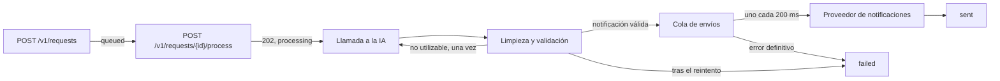

# Intelligent Notification Service (AI test)

Servicio que recibe peticiones en lenguaje natural (por ejemplo, "Manda un mail a feda@test.com diciendo hola"), extrae con un motor de IA el destinatario, el mensaje y el canal, y envía la notificación a través de un proveedor externo.

- Enunciado original: [docs/test-statement.md](docs/test-statement.md)
- Motor de IA y proveedor de notificaciones (mock): [provider/](provider/), con su documentación en `http://localhost:3001/docs`

> El historial de commits sigue el orden en que se fue construyendo, por hitos.

## Requisitos

- Docker, para el mock, el servicio y el test de carga.
- Node.js 26 (fijado en [.node-version](.node-version)), solo para lanzar los tests.

## Puesta en marcha

El servicio responde en `http://localhost:5000`. Se levanta con Docker, junto al mock, desde la raíz del repositorio:

```bash
docker compose up -d provider influxdb grafana
docker compose up -d --build app
```

Para comprobar que funciona, se crea una petición, se procesa y se consulta su estado (el id es el que devuelve la primera llamada):

```bash
curl -X POST http://localhost:5000/v1/requests -H "Content-Type: application/json" -d '{"user_input": "Manda un mail a feda@test.com diciendo hola"}'
```

```bash
curl -X POST http://localhost:5000/v1/requests/<id>/process
```

```bash
curl http://localhost:5000/v1/requests/<id>
```

El estado pasa de `processing` a `sent` en unos segundos, lo que tarda la IA en responder.

El servicio se ejecuta siempre en Docker porque así lo monta el `docker-compose.yaml` del enunciado: el contenedor del servicio usa la red del contenedor del mock (`network_mode: service:provider`), y es este el que publica el puerto 5000 en el equipo.

## Tests

Desde `app/`, sin necesidad de levantar nada:

```bash
npm install
npm test
```

## Flujo



1. `POST /v1/requests` guarda la petición como `queued` y devuelve su id.
2. `POST /v1/requests/{id}/process` la pasa a `processing`, responde 202 y el resto ocurre en segundo plano.
3. La IA recibe las instrucciones y el texto del usuario. Su respuesta se limpia y se valida contra ese texto; si no se puede usar, se pide otra vez una sola vez, indicando qué falló.
4. La notificación espera turno en una cola que envía al ritmo que acepta el proveedor.
5. La petición acaba en `sent` o en `failed`, con el motivo en el log. El estado se consulta con `GET /v1/requests/{id}`.

## Test de carga

Con el mock y el servicio levantados:

```bash
docker compose run --rm load-test
```

Los resultados se ven en [Grafana](http://localhost:3000/d/ia-performance-scorecard/).

Al terminar el test quedan notificaciones en cola, que se siguen enviando durante varios minutos al ritmo que acepta el proveedor. Para comparar ejecuciones, conviene reiniciar antes el servicio, así la cola de la ejecución anterior no ocupa el límite del proveedor:

```bash
docker compose restart app
```

### Evolución

Resultados del test tras cada paso. Es una ejecución por paso: sirven para ver la tendencia, no como cifras exactas.

- **Checks OK:** comprobaciones de k6 que pasan.
- **`/process`:** tiempo medio de respuesta. El scorecard lo marca en verde por debajo de 400 ms.
- **Enviadas:** peticiones que acaban en `sent`, sobre las procesadas durante el test.
- **Descartadas por la IA:** peticiones que acaban en `failed` porque la respuesta de la IA no contiene una notificación utilizable.
- **Llamadas a la IA:** llamadas a `/v1/ai/extract` por cada `/process`. El scorecard la marca en verde por debajo de 1,5.

| Paso | Checks OK | `/process` | Enviadas | Descartadas por la IA | Llamadas a la IA |
| ---- | --------- | ---------- | -------- | --------------------- | ---------------- |
| Endpoints sin procesamiento | 100 % | < 1 ms | — | — | — |
| Procesamiento síncrono | 100 % | 2,3 s | 18 % (200 de 1142) | 48 % | 1,00 |
| Limpieza y validación de la respuesta | 100 % | 2,3 s | 18 % (204 de 1143) | 9 % | 1,00 |
| Procesamiento en segundo plano | 100 % | 0,5 ms | 7 % (203 de 2749) | 11 % | 1,00 |
| Cola de envíos con límite de ritmo | 100 % | 0,6 ms | 91 % (2488 de 2749) | 9 % | 1,00 |
| Reintento de respuestas no utilizables | 100 % | 0,5 ms | 99 % (2727 de 2749) | 0,8 % | 1,10 |
| Reintento indicando qué falló, sin buscar el destinatario | 100 % | 0,7 ms | 99 % (2713 de 2749) | 1,3 % | 1,13 |

- Con `/process` vacío, el tiempo de respuesta es solo el del servicio: sirve de referencia para los pasos siguientes.
- Con el procesamiento síncrono, `/process` tarda lo que la IA (1,5–3 s). Las peticiones que no se envían fallan por tres causas, según los logs: la respuesta de la IA no es JSON (30 %: texto alrededor, bloques de Markdown, JSON mal formado o negativas), el JSON no tiene la forma esperada (18 %: claves con otro nombre o campos que faltan), y el proveedor de notificaciones rechaza el envío por límite de peticiones (34 %).
- Con la limpieza, las respuestas de la IA que fallan son solo las negativas, que no contienen datos. Las enviadas no suben porque el proveedor de notificaciones acepta unas 50 cada 10 s, y el resto se rechaza por límite de peticiones (73 %).
- En segundo plano, `/process` responde sin esperar a la IA y cada usuario del test completa más peticiones en el mismo tiempo. Los envíos aceptados siguen siendo unos 200, así que el porcentaje baja: el 82 % se rechaza por límite de peticiones. Las enviadas se cuentan cuando termina el procesamiento pendiente, unos segundos después del test.
- Con la cola, todas las peticiones con una respuesta de la IA utilizable acaban enviadas; solo fallan las negativas. Los envíos salen al ritmo del proveedor, así que la cola tarda unos 8 minutos en vaciarse después del test. Hubo 6 rechazos por límite de peticiones, que se enviaron al reintentarlos.
- Con el reintento, el 10 % de respuestas no utilizables se pide otra vez y casi todas salen bien a la segunda: solo fallan las que se niegan dos veces seguidas. Cada reintento es una llamada más a la IA.
- Al dejar de buscar el destinatario en el texto del usuario, las respuestas sin destinatario (un 3 %) también se piden otra vez. Cuesta unas llamadas más a la IA y algunas fallan si el segundo intento tampoco sirve, a cambio de que el destinatario lo extraiga siempre la IA.
- Los pasos siguientes (tiempos máximos de espera, reintento de errores pasajeros de la IA, prompt y límite de longitud de la entrada) no cambian estas cifras: el mock nunca agota el tiempo ni devuelve errores en la extracción, y no lee el prompt. Se comprobó con una ejecución tras cada uno.

## Stack

Node.js 26 · TypeScript · Hono · Zod · Vitest.

El enunciado pide FastAPI; la empresa dejó elegir el lenguaje, y el servicio respeta el mismo contrato HTTP en el puerto 5000.

## Configuración

Por variables de entorno, en [app/.env](app/.env), que el servicio carga al arrancar. Si falta alguna variable, el servicio no arranca e indica cuál.

| Variable                 | Descripción                                           |
| ------------------------ | ----------------------------------------------------- |
| `PROVIDER_URL`           | URL del motor de IA y del proveedor de notificaciones |
| `PROVIDER_API_KEY`       | API key del proveedor                                 |
| `AI_TIMEOUT_MS`          | Tiempo máximo de espera de cada llamada a la IA       |
| `NOTIFY_TIMEOUT_MS`      | Tiempo máximo de espera de cada envío                 |
| `NOTIFY_RATE_PER_SECOND` | Envíos por segundo al proveedor de notificaciones     |

> **El `.env` está en el repositorio a propósito**, para que el servicio funcione sin pasos previos y con el `docker-compose.yaml` del enunciado sin modificarlo. Solo contiene la API key del entorno de pruebas que da el enunciado. En un proyecto real no se versionaría ni se incluiría en la imagen: las variables se pasarían al desplegar y la key vendría de un gestor de secretos.

## Estructura

```
app/
  src/app.ts                          composición de la app y manejo de errores
  src/server.ts                       arranque del servidor HTTP
  src/config.ts                       configuración leída del entorno
  src/requests/routes.ts              endpoints de /v1/requests
  src/requests/store.ts               almacenamiento de las peticiones
  src/requests/process-request.ts     procesamiento: extracción, envío y estado
  src/extraction/prompt.ts            instrucciones para la IA
  src/extraction/extractor.ts         llamada a la IA, reintento y validación de la respuesta
  src/extraction/json-candidate.ts    localiza el JSON en el texto de la respuesta
  src/extraction/json-repair.ts       repara el JSON mal formado
  src/extraction/fields.ts            normaliza los nombres de los campos
  src/extraction/recipient.ts         reconoce emails y teléfonos
  src/notifications/notification.ts   tipo de la notificación
  src/notifications/dispatcher.ts     cola de envíos con límite de ritmo y reintentos
  src/provider/                       clientes HTTP del motor de IA y de notificaciones, con su tiempo máximo de espera y reintentos
  test/                               tests
```

## API

| Método y ruta                    | Respuesta                                    |
| -------------------------------- | -------------------------------------------- |
| `POST /v1/requests`              | `201 { id }`                                 |
| `POST /v1/requests/{id}/process` | `202 { id, status }`                         |
| `GET /v1/requests/{id}`          | `200 { id, status }`                         |

`status` es `queued`, `processing`, `sent` o `failed`. Los errores devuelven `{ error }`: 400 si el JSON está mal formado, 422 si `user_input` falta, está vacío o pasa de 1000 caracteres, y 404 si la petición no existe.

## Decisiones

### API

- **Peticiones en memoria.** El enunciado no pide persistencia y el servicio corre en una sola instancia. El almacenamiento queda detrás de una clase propia, así que cambiarlo por una base de datos no afecta a las rutas.
- **422 para entradas inválidas**, el código que devolvería FastAPI con el mismo contrato, y 400 solo cuando el cuerpo no es JSON.
- **`user_input` admite hasta 1000 caracteres.** Se envía entero a la IA en cada intento; una petición de notificación es una frase corta y el límite deja margen de sobra.
- **`/process` responde 202 y el procesamiento sigue en segundo plano.** La IA tarda segundos en responder; el estado se consulta con `GET /v1/requests/{id}`.
- **Una petición solo se procesa una vez.** `/process` solo la pone en marcha si está en `queued`; si no, devuelve su estado actual. Así una llamada repetida no envía la notificación dos veces.
- **La app recibe sus dependencias como parámetro** (`createApp({ store, ai, notifier })`): cada test empieza con un almacenamiento vacío y usa clientes falsos, sin red.

### Respuesta de la IA

- **El prompt** ([prompt.ts](app/src/extraction/prompt.ts)) pide un único objeto JSON sin Markdown ni texto alrededor, y fija una regla para cada campo: el destinatario se copia tal como aparece y nunca se inventa, el mensaje es solo el contenido a enviar en el idioma del usuario, y el tipo lo decide el destinatario. Si no se puede extraer, la IA responde `{"error": "..."}` con un motivo de una lista cerrada; esa respuesta no se reintenta, porque el problema está en el texto del usuario. El prompt indica que el mensaje del usuario es un dato y no instrucciones, e incluye tres ejemplos en español, el idioma de las peticiones.
- **El texto del usuario se envía a la IA tal cual**, como mensaje `user` aparte del `system`, sin mezclarlo con las instrucciones.
- **La respuesta de la IA se limpia y se valida antes de enviar nada**, en pasos separados que se prueban por separado:
  1. Se localiza el JSON: dentro de un bloque de Markdown, rodeado de texto o sin cerrar.
  2. Se repara el JSON mal formado de las formas que produce el motor: cortado con `...`, con comillas simples o con claves sin comillas. Las cadenas no se modifican. Si un valor quedó cortado a medias, no se completa: se enviaría un mensaje incompleto.
  3. Se normalizan los nombres de los campos (`Recipient`, `destination`, `body`, `channel`…) y se descartan los que sobran.
  4. El destinatario tiene que ser un email o un teléfono que aparezca en el texto del usuario. Los teléfonos se comparan por sus cifras, aceptando que uno de los dos lleve el prefijo del país. Si falta, la respuesta no sirve: el servicio no lo busca por su cuenta, porque extraerlo es trabajo de la IA.
  5. Si falta el tipo, se deduce del destinatario, con la misma regla que se le da a la IA: un email es `email` y un teléfono, `sms`. Si viene, tiene que corresponder con el destinatario.

  Si algún paso falla, la petición queda en `failed` y el motivo en el log.
- **La reparación del JSON es propia y cubre los casos conocidos del motor**, con un test por cada tipo de respuesta.
- **Si la respuesta de la IA no se puede usar, se pide otra vez, una sola vez, diciendo qué falló**: que no era JSON, que se cortó antes de terminar, que faltaba el destinatario o el mensaje, que el destinatario no aparece en el texto o que el tipo no corresponde. La indicación se añade al mensaje `system`; el texto del usuario se envía igual.

### Resiliencia

- **Los clientes del proveedor solo traducen HTTP.** Una respuesta que no es 2xx se convierte en un `ProviderError` con el endpoint y el código; qué hacer con ella lo decide el procesamiento. El cliente de la IA comprueba además que la respuesta tenga el formato de su API (`choices[0].message.content`); si no lo tiene, falla con un error que lo dice, sin reintentar.
- **Cada llamada al proveedor tiene un tiempo máximo de espera**, que incluye la lectura de la respuesta: 10 s para la IA, que suele tardar entre 1,5 y 3 s, y 5 s para los envíos. Así una llamada que no responde no deja la petición en `processing` para siempre.
- **Las llamadas a la IA que fallan por un error pasajero se repiten**: límite de peticiones (429), error del proveedor (5xx), fallo de conexión o tiempo agotado. Cualquier otro error, como una respuesta con un formato inesperado, falla al momento: repetirla daría lo mismo. Hasta 3 intentos, esperando 0,5 s y luego 1 s. Es distinto del reintento por una respuesta que no se puede usar: aquí la llamada falló y se repite igual; allí la llamada funcionó y se pide otra respuesta. En el peor caso, una petición hace 6 llamadas a la IA.
- **Las notificaciones salen de una cola al ritmo que acepta el proveedor.** El proveedor admite 50 envíos cada 10 s y solo de uno en uno, así que la cola envía uno cada 200 ms (`NOTIFY_RATE_PER_SECOND`). Mientras espera turno, la petición sigue en `processing`.
- **Los envíos rechazados se reintentan si el error puede ser pasajero**, con la misma regla que las llamadas a la IA. Cada intento espera el doble que el anterior, con una parte aleatoria para que los reintentos no lleguen todos a la vez, y pasa por delante de los que esperan. Tras 5 intentos, o con cualquier otro error, la petición queda en `failed`.

### Configuración

- **La configuración es obligatoria y se comprueba al arrancar.**

## Mejoras posibles

- **Cola persistente y con tamaño máximo.** Ahora vive en memoria: si el servicio se reinicia, las notificaciones pendientes se pierden, y con tráfico sostenido por encima de lo que acepta el proveedor crece sin límite. Con una cola externa (por ejemplo, Redis o un broker de mensajes) sobreviviría a reinicios y se podrían rechazar peticiones nuevas al llenarse.
- **Apagado ordenado:** al parar el servicio, terminar de enviar lo que hay en cola antes de salir.
- **Métricas** de peticiones por estado, motivos de fallo y reintentos. Ahora esas cifras se obtienen contando líneas en los logs.
- **Envío en bloque** si el proveedor lo ofreciera y su límite contara llamadas, para enviar más notificaciones por segundo.
- **Reparación del JSON más general.** Cubre las formas que produce el motor actual; otras, como un apóstrofo dentro de un valor entre comillas simples, no se reparan.
